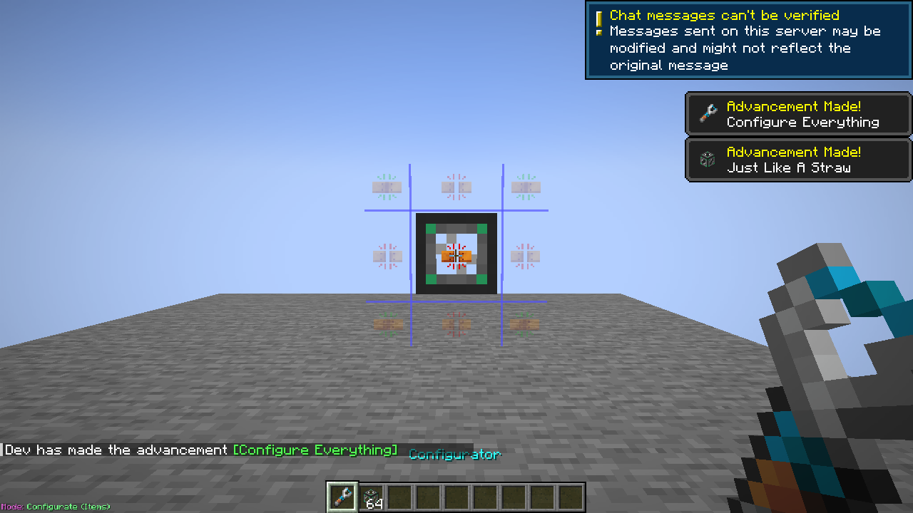
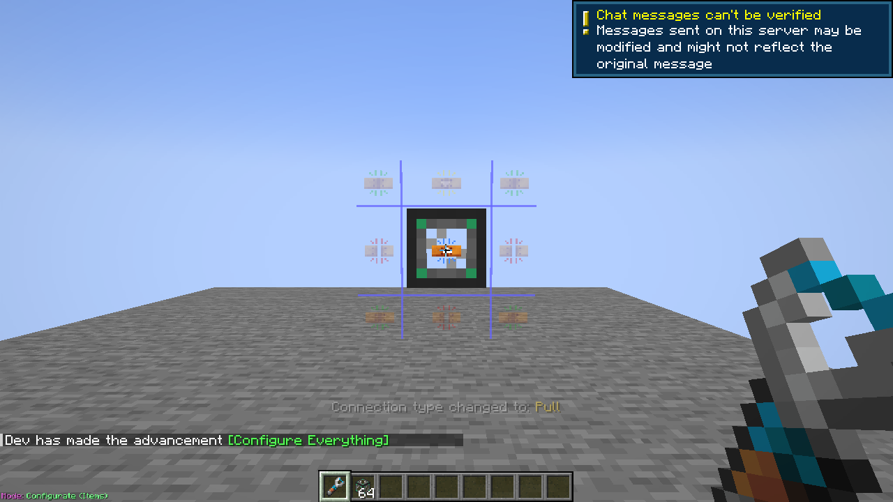
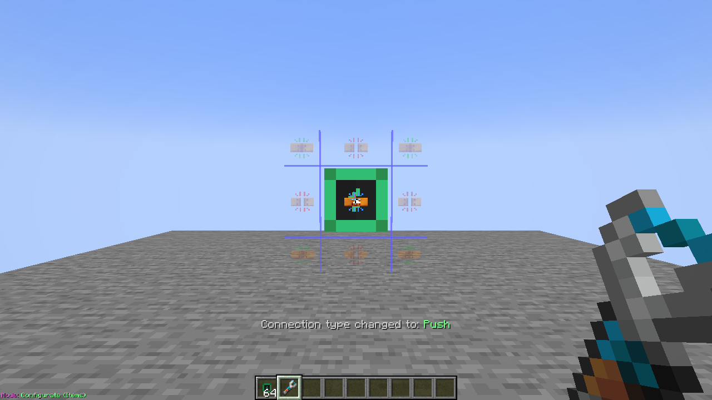
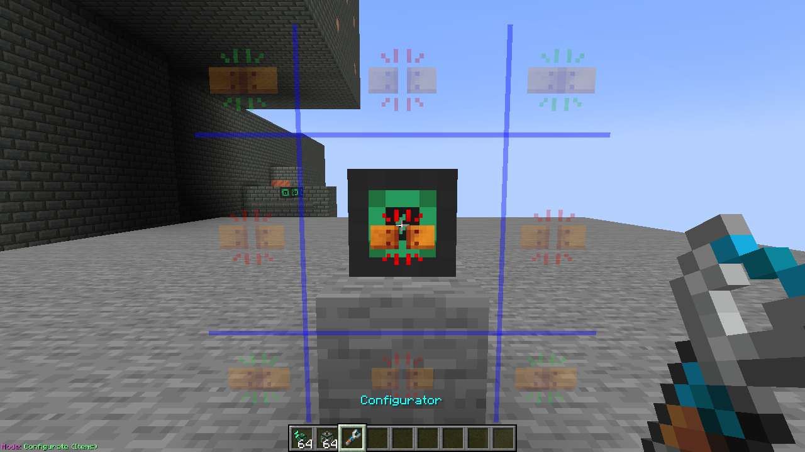
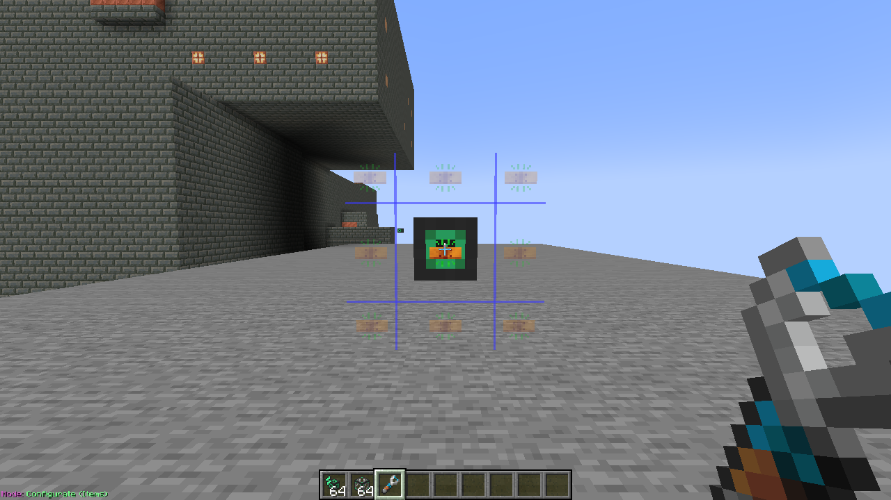
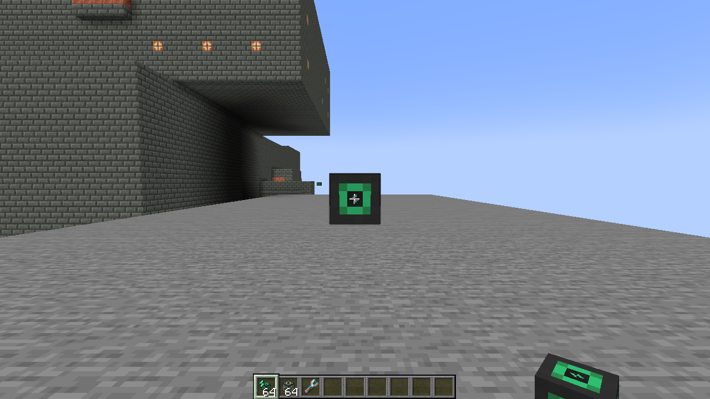
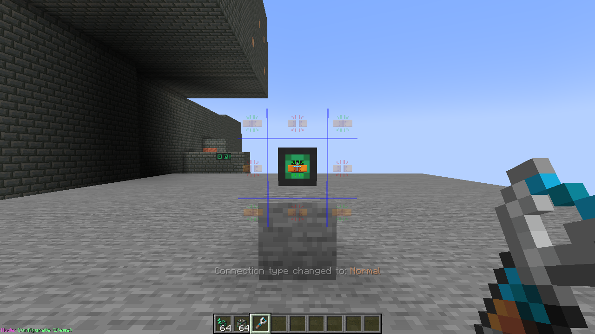

# Mekanism Pipe Tweaks — in-game verification report

Date: 2026-11-20/21
Target: Minecraft 1.21.1 · NeoForge 21.1.264 · Mekanism 10.7.19 · mod 0.1.0
Method: temporary client-side `AutoTest` harness, dedicated server + dev client under Xvfb `:99`
(1280x720, Mesa llvmpipe), driven from outside with a stdlib Python RCON client.

All four screenshots were produced by an unmodified mod build; the harness only
performs ordinary player actions (item selection, `gameMode.useItemOn`, teleport,
sneak packets) and captures the main render target.

---

## 1. Screenshots

### screenshot-1-guide.png — GregTech 3x3 guide

The player stands 1.2 blocks west of the anchor pipe at `(14, 4, 14)`, holding the
Configurator, with the crosshair exactly on the pipe's west face centre.

* Client hit result: `pos=14,4,14 face=west location=(14.25, 4.50005, 14.5)`
  → `target cell=west col=1 row=1 mode=CONFIGURATOR`.
* The 3x3 grid is drawn on the whole block face (grid lines at ±0.25, icons at
  ±0.375), exactly as `docs/DESIGN.md` §5.1 describes. The hovered centre icon is
  at 100% opacity, the other eight at 27%. No cell backgrounds, no white frames.
* The left/right columns extend past the (thin) pipe core onto the arm/air, which
  is the intended GT behaviour: the grid describes the *block face*, not the pipe.
* The hotbar shows the selected Configurator, proving the display condition.

Note: the pipe core is 0.5 blocks wide (the hit is exactly on `x=14.25`), so the
icons at ±0.375 sit outside the pipe model — expected, same as GT.

### screenshot-2-placement.png — placed pipe connects only toward the clicked side

Scene: anchor pipe A `(14,4,14)` (placed with `/setblock`, i.e. vanilla placement),
the pipe C the player placed `(14,4,15)`, and an unrelated pipe D `(14,4,16)`
(also `/setblock`, all six faces `NORMAL` and directly adjacent to C).

The player held `basic_mechanical_pipe`, faced A's south face and called
`gameMode.useItemOn`. Server-side connection data read back from the client tile:

```
anchor (14,4,14): down=NORMAL/NONE up=NORMAL/NONE north=NORMAL/NONE
                  south=NORMAL/NORMAL west=NORMAL/NONE east=NORMAL/NONE
placed (14,4,15): down=NONE/NONE up=NONE/NONE north=NORMAL/NORMAL
                  south=NONE/NONE west=NONE/NONE east=NONE/NONE
extra  (14,4,16): down=NORMAL/NONE up=NORMAL/NONE north=NORMAL/NONE
                  south=NORMAL/NONE west=NORMAL/NONE east=NORMAL/NONE
```

So C has exactly one configured and effective connection (north, toward A), the
counterpart side of A was opened symmetrically, and C did **not** auto-connect to
the adjacent pipe D even though D's raw connection is `NORMAL` on that side
(mutual-consent check works). In the image the middle green band is the single
connection arm; the pipe on the right is D and has no arm.

### screenshot-3-cycle.png — sneak + right-click cycles the looked-at side

The player sneaks (real `PRESS_SHIFT_KEY`/`RELEASE_SHIFT_KEY` packets plus
`player.input.shiftKeyDown`, which is what `LocalPlayer.isShiftKeyDown()` reads)
and right-clicks the same west face.

* `(14,4,14) west` changed `NORMAL → PUSH` (raw/effective `PUSH/NONE`, since there
  is no neighbour on that side).
* The guide's centre icon switches to the PUSH texture: the radiation marks are
  now blue and the small white direction triangle is drawn.
* The action bar shows the mod's own feedback: **“Connection type changed to: Push”**.

### screenshot-4-cell-place.png — cell-select placement (best effort)

Holding the pipe item again, the harness hovers the **top cell** of the guide
(`cell side=up col=1 row=0`) on A's west face and activates it. Result:

```
anchor  (14,4,14): ... up=NORMAL/NORMAL   (counterpart side opened)
new pipe(14,5,14): down=NORMAL/NORMAL, all other faces NONE/NONE
```

The pipe was placed **above** A (the selected cell's direction), not on the
clicked west side, and it connects only downward — i.e. the cell-selection
placement path works server-side. The camera view also shows the placement guide
(held pipe item) on A.

Important caveat (historical, fixed in §4): this original result was produced with a
**synthesised** hit position (`y = 4.875`, i.e. `v = +0.375`). A real player could not
reach a non-centre cell at the time — see finding B below. The §4 fix round re-captured
this screenshot using only a real crosshair aim.

---

## 2. Phase log (final run)

```
world_ready player=Dev ... fov=70
setup_done pipeSlot=1 configuratorSlot=0 emptySlot=3
phase -> PLACE_TP     arrived at (15.5, 3.0, 16.8)
placement click       anchor=(14,4,14) face=SOUTH item=mekanism:basic_mechanical_pipe
placement useItemOn -> SUCCESS
phase -> PLACE_SETTLE placed block at (14,4,15): mekanism:basic_mechanical_pipe transmitter
phase -> PLACE_VIEW_TP / PLACE_VIEW   screenshot-2-placement.png
phase -> GUIDE_TP     guide position (13.3, 3.0, 14.5) holding mekanism:configurator
guide hitResult       face=west location=(14.25, 4.50005, 14.5) cell=west col=1 row=1
                      screenshot-1-guide.png
cycle                 raw before=NORMAL, sneaking=true
cycle useItemOn -> SUCCESS      cycle result: anchor west raw=PUSH
                      screenshot-3-cycle.png
cell placement        synthetic hover ... cell side=up col=1 row=0
cell placement useItemOn -> SUCCESS
cell placed at (14,5,14)   screenshot-4-cell-place.png
phase -> DONE         failure=none cycleChanged=true cellPlaced=true
```

Full logs: `verification/logs/client-latest.log`, `server.log`, `rcon-driver.log`.

---

## 3. Findings / failures

**A. Block ids in the brief do not exist in Mekanism 10.7.**
`mekanism:mechanical_pipe` and `mekanism:universal_cable` are not registered;
Mekanism 10.7 uses tiered ids. `/setblock` reported
`Unknown block type 'mekanism:mechanical_pipe'`. The harness used
`mekanism:basic_mechanical_pipe` / `mekanism:basic_universal_cable`
(confirmed against `assets/mekanism/lang/en_us.json`). Worth remembering for
README/examples.

**B. Cell-select placement is unreachable with a real crosshair (bug / spec gap).**
The transmitter core is 0.5 blocks wide, so the hit position on a face can only
have `|u|,|v| <= 0.25`. `GuideGeometry.CELL_BOUNDARY` is exactly `0.25` and the
tests are `u < -0.25` / `u > 0.25`, so `cellAt()` always returns `col=1,row=1`
(the looked-at face). `GuideInteractionHandler` then returns early because
`cell.side() == face`. Net effect: a player can never select a non-centre cell,
so the GT-style cell placement of §5.1 cannot be triggered by real input.
Fix options: expand the transmitter selection shape to the full block while the
guide item is held (as DESIGN §5.1 already calls for, but which is not
implemented), or derive the cell from the crosshair ray against the face plane
instead of the pipe hit position. Screenshot 4 therefore required a synthetic
hit vector to exercise the server-side path.

**C. Sneak state must come from the input, not `Entity.setShiftKeyDown`.**
`LocalPlayer.isShiftKeyDown()` returns `input.shiftKeyDown`, and `aiStep()`
overwrites the entity flag every tick, so the harness must set
`player.input.shiftKeyDown` (and send `ServerboundPlayerCommandPacket`
PRESS/RELEASE_SHIFT_KEY). Without the packets the server still sees a normal
right-click: the server-side `RightClickBlock` cancel is skipped and the
Configurator performs its own sneak action (“Redstone sensitivity turned on”
appeared in the action bar instead of the mod message). With them, the
cycle works through the real client handler
(`GuideInteractionHandler` → `CycleSidePayload`) and the mod's action-bar
message is shown.

**D. Intermittent double placement from the cell click (observed in iterations 3–4).**
In two earlier runs, the cell-select click also produced a vanilla-placed pipe at
the clicked face, `(13,4,14)`, with NBT
`connection: [3,3,3,3,3,0]` (only EAST = `NORMAL`, i.e. toward the anchor).
That is exactly what `TransmitterPlacementLogic.applyOpen(openSide=EAST)`
produces for a click recorded on the anchor's west face. Cause: the client-side
event cancel in `GuideInteractionHandler` does not stop
`MultiPlayerGameMode.startPrediction()` from sending `ServerboundUseItemOnPacket`
(see `MultiPlayerGameMode.useItemOn`/`startPrediction` — the packet is always
sent), so the server runs the vanilla placement in addition to the custom
`PlaceTransmitterPayload`. In the final run this did not reproduce, so it is
probably ordering/timing dependent, but the code path remains. Suggested fix:
have the client skip the packet when the guide intercepts the click (or make the
server-side handler ignore a right-click that carries the guide's synthetic
cell hit), and/or reject the vanilla placement when a `PlaceTransmitterPayload`
already handled it.

**E. Environment notes (not mod issues).**
* NeoForm Runtime’s asset downloader uses `http://resources.download.minecraft.net`,
  which Mojang now answers with `AccountRequiresHttps`; the download hangs. The
  asset cache was pre-populated over HTTPS (all 3913 index entries, 148 large
  music files fetched with retries), after which the launch tasks ran normally.
* Two long-running Gradle `run*` tasks cannot share one `GRADLE_USER_HOME`
  (journal lock), so the server was started directly from its generated command
  line (`build/moddev/testServerRunVmArgs.txt` + `testServerRunProgramArgs.txt`)
  after the first build; the client kept using the Gradle run task.
* The dedicated-server launcher logs `No key layers in MapLike[{}]` for the
  flat world preset; harmless in 1.21.1.

---

## 4. Fix round (2026-11-21): bugs B and D closed

### 4.1 What changed (event-based, no Mixin)

**Bug B — real-crosshair cell selection.**

* New client-only `GuideTargeting` performs a `ClipContext` ray from the player's eye
  along the look vector up to `Player.blockInteractionRange()`, with a custom shape
  getter that returns `Shapes.block()` for `BlockTransmitter` blocks and the normal
  outline shape for everything else. No block shape (collision or selection) is changed.
* `GuideTarget` now resolves from that expanded raycast instead of the vanilla hit, so
  the guide target/face/cell use the full face plane (`|u|,|v|` up to 0.5). The nearest
  hit still wins, and a normal block in front of a transmitter hides it.
* `GuideRenderer` draws the grid from `RenderLevelStageEvent.AFTER_ENTITIES` using the
  same expanded target, so the grid appears and the hovered cell follows the crosshair
  even when the vanilla ray misses the thin pipe. The vanilla outline is cancelled while
  a guide target is active.
* `GuideInteractionHandler` resolves the expanded target in both
  `RightClickBlock` and `RightClickItem`. It sends `PlaceTransmitterPayload` whenever the
  expanded hit selects a redirected cell, covering (a) the vanilla ray hitting a farther
  block and (b) the vanilla ray being a plain item use. The Configurator cycle path is
  unchanged: it still uses the hovered cell side and requires sneak.

**Bug D — one-shot server guard.**

* `PlaceTransmitterPayload` now also carries the actually-clicked face
  (`target.face()` from the expanded hit).
* When the payload handler successfully places (`InteractionResult.consumesAction()`),
  `TransmitterPlacementLogic` records a one-shot guard: player UUID, target position,
  clicked face, expiry `gameTime + 10`.
* The server `PlayerInteractEvent.RightClickBlock` handler (HIGHEST) checks the guard
  before recording a click. On a matching live mark it consumes the mark, cancels the
  event completely (block and item use denied) and writes no click record. On a
  non-match or after expiry the click proceeds normally. A failed payload sets no mark.

### 4.2 Retest method

The temporary `AutoTest` harness was recreated (then removed again) and driven exactly
as in §2: dedicated server started from its generated command line, dev client under
Xvfb `:99` at 1280x720, RCON driver for world setup/teleports/server-side block checks.
The cell phases use only a real crosshair aim and the normal `gameMode` path: the
harness rotates the player, reads `Minecraft.hitResult`, and calls `gameMode.useItemOn`
when it is a block or `gameMode.useItem` when it is a miss. No synthetic hit vector is
passed into the mod.

* Cell aim: player eye at `(12.6, 4.62, 14.5)` looking through `(14.0, 4.875, 14.5)` —
  the top cell of the anchor's west face, above the 0.5-wide pipe core.
* Five repeats at fresh anchors `(14,4,20/26/32/38/44)`, same top-cell aim.
* Guard exercise at `(14,4,50)`: player eye `(12.6, 5.62, 50.5)` aiming at
  `(14.0, 4.76, 50.5)`. The expanded ray selects the top cell, but the steeper ray also
  clips the thin core, so the vanilla path is `RightClickBlock` and the vanilla
  `ServerboundUseItemOnPacket` is sent — this is the exact double-placement race.

### 4.3 Retest evidence

Phase log (`verification/logs/rcon-driver-fix.log`, client `client-fix.log`,
server `server-fix.log`):

```
world_ready / setup_done pipeSlot=1 configuratorSlot=0
placement   hit=BLOCK face=south location=(14.361,4.426,14.750) useItemOn -> SUCCESS
guide       vanillaHit=BLOCK face=west location=(14.250,4.457,14.500)
            expanded=cell=west col=1 row=1 mode=CONFIGURATOR
cycle       sneaking=true useItemOn -> SUCCESS, anchor west raw NORMAL -> PUSH
cell aim    vanillaHit=MISS expanded=cell=up col=1 row=0 mode=PLACEMENT
cell place  (RightClickItem) -> SUCCESS
repeat[0..4] vanillaHit=MISS expanded=cell=up col=1 row=0 -> SUCCESS
guard aim   vanillaHit=BLOCK pos=(14,4,50) face=west location=(14.250,4.607,50.500)
            expanded=cell=up col=1 row=0
guard place (RightClickBlock) -> SUCCESS
```

Server-side RCON checks (`execute if block … mekanism:basic_mechanical_pipe`):

```
CHECK screenshot anchor (14,4,14): PIPE   cell (14,5,14): PIPE   duplicate (13,4,14): air
CHECK repeat0..4   anchor: PIPE           cell (14,5,z): PIPE    duplicate (13,4,z): air   (z=20..44)
CHECK guard        anchor (14,4,50): PIPE cell (14,5,50): PIPE   duplicate (13,4,50): air
```

The cell pipe connections read back as
`cell (14,5,14): down=NORMAL/NORMAL, all other faces NONE/NONE`, and the anchor's
counterpart `up` became `NORMAL/NORMAL`:

```
anchor-after-cell (14,4,14): down=NORMAL/NONE up=NORMAL/NORMAL north=NORMAL/NONE
                             south=NORMAL/NORMAL west=PUSH/NONE east=NORMAL/NONE
cell-placed      (14,5,14): down=NORMAL/NORMAL up=NONE/NONE north=NONE/NONE
                             south=NONE/NONE west=NONE/NONE east=NONE/NONE
```

The guard run matters because the client did send the vanilla use-on packet for
`(14,4,50)/WEST`; without the guard the server would have placed a second pipe at
`(13,4,50)`. That position remained air, so the guard consumed the mark and cancelled
the vanilla placement.

Screenshots were re-captured at 1280x720: `screenshot-1-guide.png` (3x3 grid on the
whole face, centre hovered), `screenshot-2-placement.png` (single configured connection,
still no auto-connect to the adjacent pipe), `screenshot-3-cycle.png` (blue PUSH
radiation marks + “Connection type changed to: Push”), and
`screenshot-4-cell-place.png` (real crosshair on the top cell; new pipe above the
anchor, grid top cell highlighted).

### 4.4 Status

* **B — closed.** A real crosshair can select all nine cells; the top-cell placement was
  reached via `RightClickItem` on a vanilla miss, and the guide follows the expanded hit.
* **D — closed.** The guard was directly exercised (vanilla `RightClickBlock` on the pipe
  core + injected redirect) and no duplicate appeared; five additional real-crosshair
  cell placements also produced exactly one pipe each.

## 5. Cleanup

The harness and both test runs were removed, `run-test-server/` and `run-test-client/`
were deleted, and a clean `gradle clean build` was run for this fix round.

* `build/libs/mekanism_pipe_tweaks-0.1.0.jar` — 53 entries,
  **no `autotest` classes** (`unzip -l … | grep -i autotest` → empty) and
  **no Mixin config** (`unzip -l … | grep -i mixin` → empty). The new
  `GuideTargeting` / `GuardRecord` classes are present.
* The fixed-run logs were preserved as `verification/logs/client-fix.log`,
  `server-fix.log` and `rcon-driver-fix.log`. Screenshots, this report, `logs/`, the
  RCON driver and the asset helper remain under `verification/`.
* The temporary `build.gradle` run tweaks (`--quickPlayMultiplayer`,
  `-Dmpt.autotest`) and the `run-test-*` game directories were reverted/deleted.

The one-off RCON and asset-fetch helpers were removed from the repository after verification;
they remain recoverable from git history.

---

## 6. Mixed-side guide capture (2026-11-21)

### 6.1 Scene and method

Capture-only run with the same temporary `AutoTest` harness (§2/§4), a dedicated server
started from its generated command line, and the dev client under Xvfb `:99` at
1280x720. No mod source behaviour was changed for the run.

1. Anchor **A** at `(14,4,14)` was placed with `/setblock`.
2. The player placed pipe **C** at `(14,4,15)` through the normal gameplay path: the
   harness selected the pipe item, aimed at A's south core face and called
   `gameMode.useItemOn`. Logged hit:
   `anchor=(14,4,14) face=south location=(14.500, 4.500, 14.750)`,
   `placement useItemOn -> SUCCESS`.
3. C's client-tile connection types read back before any cycling:

```
C (14,4,15) raw: down=NONE up=NONE north=NORMAL south=NONE west=NONE east=NONE
```

   So C has exactly one configured connection, `north` (toward A), and the side pointing
   away from A is `south` (all NONE). The player then viewed C's **south** face
   (view face = `south`, eye at `(14.5, 4.62, 18.0)`, crosshair through
   `(14.5, 4.5, 16.0)`) while holding the Configurator.

The viewed face maps to the guide cells through `GuideGeometry.sideFor(SOUTH, col, row)`:
centre = south, top/bottom edges = up/down, left/right edges = west/east, and all four
corners = north (the opposite face).

### 6.2 Screenshot 5 — mixed NONE / NORMAL guide

[](screenshot-5-mixed-guide.png)

Guide target at capture:
`vanillaHit=BLOCK pos=(14,4,15) face=south location=(14.500, 4.485, 15.750)`,
`expanded=cell=south col=1 row=1 face=south mode=CONFIGURATOR`.

Observed: the centre and the four edge cells show the **block/disconnected icon**
(joined pipe + red radiation); the four corner cells show the **connect icon**
(split pipe + green radiation). The centre cell is drawn at full opacity because it is
the hovered cell.

### 6.3 Cycling through the real sneak + right-click path

With the same south face in view, the harness cycled C's sides using real
`PRESS_SHIFT_KEY`/`RELEASE_SHIFT_KEY` packets, `player.input.shiftKeyDown = true`, and
`gameMode.useItemOn` (the §3-C path), then read C's raw types again:

* Centre cell (side `south`), two cycles: `NONE -> NORMAL -> PUSH`
  (logged raw before each click: `NONE`, then `NORMAL`).
* Top cell (side `up`), three cycles: `NONE -> NORMAL -> PUSH -> PULL`
  (logged raw before each click: `NONE`, `NORMAL`, `PUSH`).

Client-tile readback after:

```
C (14,4,15) raw: down=NONE up=PULL north=NORMAL south=PUSH west=NONE east=NONE
```

Cross-checks:

* Full raw/effective line from the client tile:
  `down=NONE/NONE up=PULL/NONE north=NORMAL/NORMAL south=PUSH/NONE west=NONE/NONE east=NONE/NONE`.
  The guide deliberately shows the **configured/raw** value (§5.2-6); `PUSH` and `PULL`
  have effective `NONE` here because those faces have no neighbour.
* Server-side block NBT (RCON `data get block 14 4 15`) agreed at every check:
  after the centre cycles `connection:[I; 3,3,0,1,3,3]`, and after the top cycles /
  final `connection:[I; 3,2,0,1,3,3]` (Direction order
  down,up,north,south,west,east with NORMAL=0, PUSH=1, PULL=2, NONE=3).
* Screenshot 6 shows the Configurator's own action bar message
  “Connection type changed to: Pull”, confirming the click went through the real path.

### 6.4 Screenshot 6 — all four icon kinds on one face

[](screenshot-6-all-types.png)

Same viewpoint as screenshot 5. Now the centre shows **PUSH** (connect icon with blue
radiation marks and the white direction triangle), the top edge shows **PULL** (connect
icon with yellow radiation marks and the white triangle), the four corners remain
**NORMAL** (connect icon, green radiation), and the left/right/bottom edges remain
**NONE** (block icon, red radiation).

### 6.5 Cell-by-cell result for the viewed (`south`) face

| Cell (row,col) | Kind | Mapped side | Raw before | Icon seen before | Raw after | Icon seen after |
|----------------|------|-------------|------------|------------------|-----------|-----------------|
| (0,0) | corner (top-left) | north | NORMAL | connect (green) | NORMAL | connect (green) |
| (0,1) | edge (top) | up | NONE | block (red) | PULL | pull (connect + yellow + triangle) |
| (0,2) | corner (top-right) | north | NORMAL | connect (green) | NORMAL | connect (green) |
| (1,0) | edge (left) | west | NONE | block (red) | NONE | block (red) |
| (1,1) | centre | south | NONE | block (red) | PUSH | push (connect + blue + triangle) |
| (1,2) | edge (right) | east | NONE | block (red) | NONE | block (red) |
| (2,0) | corner (bottom-left) | north | NORMAL | connect (green) | NORMAL | connect (green) |
| (2,1) | edge (bottom) | down | NONE | block (red) | NONE | block (red) |
| (2,2) | corner (bottom-right) | north | NORMAL | connect (green) | NORMAL | connect (green) |

### 6.6 Result

**The icons matched the configured states exactly.** On a pipe with mixed raw types the
guide renders four distinct icon outcomes simultaneously on one face: `NONE` (block),
`NORMAL` (connect), `PUSH` (connect + blue radiation + white triangle) and `PULL`
(connect + yellow radiation + white triangle), each in the cell whose mapped side carries
that configured connection type. No contradiction with the intended icon behaviour was
found.

Artifacts: `screenshot-5-mixed-guide.png`, `screenshot-6-all-types.png`,
`logs/client-s6.log`, `logs/server-s6.log`, `logs/rcon-driver-s6.log`.

---

## 7. Addon-transmitter generalisation and fake-addon proof (2026-11-21, mod 0.1.1)

### 7.1 Audit: every transmitter decision uses only Mekanism base classes and public API

All 16 source files in `src/main/java` were re-read after the interrupted edit round. The
completed audit leaves no registry-id checks, no list of vanilla block ids and no
reference to a concrete per-type Mekanism tile/transmitter class. The decisions are:

| Decision | API used |
|----------|----------|
| "Is this block a transmitter?" | `BlockTransmitter<?>` |
| "Is this its tile / get its transmitter?" | `TileEntityTransmitter#getTransmitter()` |
| "Which transmission types does it support?" | `Transmitter#getSupportedTransmissionTypes()` |
| "Is this the Configurator (tool or guide mode)?" | `ItemConfigurator` |
| "What connection does a side currently have?" | `Transmitter#getConnectionTypeRaw(Direction)` / `#getConnectionType(Direction)` |

`TransmitterSupport` is the only place that maps a transmitter to the config flags.
`typesOf(Block)` builds a detached tile through `BlockTransmitter#getTileType()` and reads
the transmitter's supported types, so a block is classified by its own tile, not by its
name. `isEnabled(Transmitter)` does the same from a live transmitter. A transmitter that
supports several types is governed when **any** supported type is enabled and is left
alone only when **all** are disabled; an unknown/empty type set is treated permissively
so addon transmitters are never silently ignored. A detached tile that cannot be created
falls back to the same permissive empty set instead of throwing. No change was needed in
`MPTConfig` beyond its existing per-`TransmissionType` mapping, and `TransmitterPlacementLogic`
had already been switched to `BlockTransmitter<?>`.

`README.md` now states that transmitters added by other Mekanism addons are supported
automatically. The mod version was bumped to 0.1.1 and the description expanded to name
addon transmitters.

### 7.2 The fake addon

A separate project was created at `~/workspace/mpt-fake-addon/` with its own modid
`mpt_fake_addon` and **no dependency on `mekanism_pipe_tweaks`**:

* `MptFakeAddon` registers one block (`mpt_fake_addon:fake_cable`) as a
  `BlockSmallTransmitter` (a `BlockTransmitter` subclass), its own block-entity type, and a
  `BlockTypeTile` with an `AttributeTier(CableTier.BASIC)` so Mekanism's tier lookup works.
* `TileEntityFakeCable extends TileEntityTransmitter` **directly** (not a concrete
  per-type tile), implements `createTransmitter` and `getTransmitterType`.
* `TransmitterFakeCable extends UniversalCable`, i.e. the ordinary energy-cable
  implementation. The block model is a small cube using Mekanism's basic cable texture.

It only uses Mekanism's public registration and transmitter API, exactly as a real addon
would. It was built into `mpt_fake_addon-1.0.0.jar` and loaded into the main project's dev
runtime through a temporary `runtimeOnly files(...)` dependency (removed after the run).

### 7.3 Run and evidence

Method was the established one (§2/§4): dedicated server started from its generated launch
script, dev client under Xvfb `:99` at 1280x720, stdlib Python RCON driver, and a temporary
client `AutoTest` harness gated by `-Dmpt.autotest`. Both logs show the expected mod list:

```
Mekanism 10.7.19 (mekanism)
Mekanism Pipe Tweaks 0.1.1 (mekanism_pipe_tweaks)
MPT Fake Addon 1.0.0 (mpt_fake_addon)
NeoForge 21.1.264 (neoforge)
```

**(a) Real placement against an anchor.** The anchor was a
`mekanism:basic_universal_cable` at `(14,4,14)`, placed with `/setblock`. Holding
`mpt_fake_addon:fake_cable`, the harness aimed at the anchor's south face and used the
normal game-mode path:

```
placement click anchor=(14,4,14) face=SOUTH item=mpt_fake_addon:fake_cable
                hit=BLOCK location=(14.500, 4.497, 14.688)
placement useItemOn -> SUCCESS
placed block at (14,4,15): mpt_fake_addon:fake_cable
connections placed  (14,4,15): down=NONE/NONE up=NONE/NONE north=NORMAL/NORMAL
                               south=NONE/NONE west=NONE/NONE east=NONE/NONE
connections anchor  (14,4,14): ... south=NORMAL/NORMAL ...
PLACE_RESULT ok=true north=NORMAL
```

Server-side NBT agreed (`Direction` order down,up,north,south,west,east;
`NORMAL=0`, `PUSH=1`, `PULL=2`, `NONE=3`):

```
placed (14,4,15): connection: [I; 3, 3, 0, 3, 3, 3]
anchor (14,4,14): connection: [I; 0, 0, 0, 0, 0, 0], connections: 8b
```

So the addon transmitter was placed with exactly one configured connection, the clicked
side (`north`, toward the anchor), every other side `NONE`, and the anchor's counterpart
side was opened. The mod applied its rules to an unknown addon block.

**(b) Guide grid on the addon transmitter.** Holding the Configurator and looking at the
placed addon block:

```
guide view holding=mekanism:configurator vanillaHit=BLOCK pos=(14,4,15) face=south
           expanded=cell=south col=1 row=1 face=south mode=CONFIGURATOR
```

The 3x3 grid and icons rendered on the addon block; the hotbar shows the fake cable and the
Configurator in the screenshot.

**(c) Sneak + right-click cycle and icon follow.** On the viewed `south` face:

```
cycle side=south #1 raw before=NONE   useItemOn -> SUCCESS
raw after cycle #1: ... south=NORMAL/NONE ...
cycle side=south #2 raw before=NORMAL useItemOn -> SUCCESS
raw after cycle #2 side=south=PUSH
```

The guide's centre cell followed: before the cycles `row=1 col=1 side=south raw=NONE
icon=block`; after them `row=1 col=1 side=south raw=PUSH icon=push` (corners stayed
`NORMAL`/connect, other edges `NONE`/block). The action bar showed the mod's own message
“Connection type changed to: Push”. Server NBT moved `[I; 3,3,0,3,3,3]` →
`[I; 3,3,0,0,3,3]` after the first cycle and → `[I; 3,3,0,1,3,3]` after the second, matching
the client readback. The captured screenshot is the PUSH state.

[](screenshot-7-addon-guide.png)

Artifacts: `screenshot-7-addon-guide.png`, `logs/client-s7.log`, `logs/server-s7.log`,
`logs/rcon-driver-s7.log`. The fake addon project remains at
`~/workspace/mpt-fake-addon/` for reproduction; it is not part of the release.

### 7.4 Cleanup and release jar

The temporary `AutoTest` class, its registration, the `run-test-*` directories and the
runtime file dependency were removed. `gradle clean build` succeeded. The release jar
`build/libs/mekanism_pipe_tweaks-0.1.1.jar` has 53 entries and contains **no
`autotest`/`mpt_fake_addon` classes and no fake-addon dependency** (checked with
`unzip -l | grep -i 'autotest|mptfake|mpt_fake'` → empty). No git commit was made.

### 7.5 Verdict

**Pass.** The mod contains no knowledge of Mekanism's concrete transmitter types or block
ids. A completely separate addon transmitter — a different block, its own block entity,
a tile extending `TileEntityTransmitter` directly and an energy transmitter — was governed
correctly with no code or configuration change: placement opened only the clicked side,
the Configurator guide rendered on it, and sneak-cycling changed the configured type with
the guide icon and server state following. The audit and the in-game proof agree.

---

## 8. Spec change 0.2.0 (2026-11-22)

### 8.1 What changed

Per `docs/DESIGN.md` §11: the guide resolves only while the Configurator is in the main
hand (the `PLACEMENT` guide mode and the transmitter-item display path are gone); cell-select
placement, `PlaceTransmitterPayload` and the server double-placement guard are removed
(ordinary right-click placement is pure vanilla, with only the post-placement connection
state rewritten); and a placed transmitter opens the clicked side only when the player is
sneaking. `connectClickedSide` gates the sneak connection and `openCounterpartSide` gates
the symmetric transmitter open. Version 0.2.0.

### 8.2 Method

Same established method as §2/§4/§7: dedicated server (`build/moddev/runServer.sh`, RCON
`25575`), dev client under Xvfb `:99` at 1280x720 with `-Dmpt.autotest=true`, and the
stdlib Python RCON driver. The temporary `AutoTest` harness drove only ordinary player
actions (teleport, item selection, look rotation, `gameMode.useItemOn`, real
`PRESS_SHIFT_KEY`/`RELEASE_SHIFT_KEY` packets) and reported `MPT_AUTOTEST` markers.

The 09:12 failure was a harness/setup problem, not a mod problem: the hotbar items were not
present (`setup_done pipeSlot=-1 configuratorSlot=-1`). In this run the driver re-issued the
hotbar setup whenever the harness reported `setup_wait`, and the harness retried until all
three items were found. The successful setup was:

```
MPT_AUTOTEST setup_wait attempt=1 pipeSlot=0 machinePipeSlot=-1 configuratorSlot=1
...
MPT_AUTOTEST setup_done pipeSlot=0 machinePipeSlot=1 configuratorSlot=2
```

The transmitted scene used `mekanism:basic_universal_cable` (A/B), a
`mekanism:basic_mechanical_pipe` against a `mekanism:basic_fluid_tank` (C), and a
`mekanism:basic_universal_cable` viewpoint pipe (D/E). Logs:
`logs/client-s10.log`, `logs/server-s10.log`, `logs/rcon-driver-s10.log`;
the driver was removed with the other one-off RCON helpers. NBT direction order below is
`down, up, north, south, west, east` with `NORMAL=0`, `PUSH=1`, `PULL=2`, `NONE=3`.

### 8.3 A — non-sneak placement against a transmitter

The anchor A `(10,4,10)` was placed with `/setblock` (so it keeps vanilla all-`NORMAL`
state). Holding the cable, not sneaking, the harness clicked the anchor's south face:

```
A place non-sneak anchor=BlockPos{x=10, y=4, z=10} clicked=SUCCESS
A_RESULT placed=down=NONE up=NONE north=NONE south=NONE west=NONE east=NONE
         anchor=down=NORMAL up=NORMAL north=NORMAL south=NORMAL west=NORMAL east=NORMAL
A_PASS ok=true
```

Server-side NBT agreed on both sides of the operation:

```
placed (10,4,11): connection: [I; 3, 3, 3, 3, 3, 3]   (all NONE)
anchor (10,4,10): connection: [I; 0, 0, 0, 0, 0, 0]   (all NORMAL, unchanged)
```

**PASS.** Without sneaking the placed transmitter is fully disconnected and the anchor is
untouched.

### 8.4 B — sneak placement against a transmitter (counterpart open)

B1 placed an anchor on plain stone without sneaking; it was all `NONE`
(`B1_PASS anchor-all-none=true`). B2 then sneaked and clicked the anchor's south face:

```
B2 place sneak anchor=BlockPos{x=14, y=4, z=20} clicked=SUCCESS
B2_PLACED_RAW down=NONE up=NONE north=NORMAL south=NONE west=NONE east=NONE
B2_ANCHOR_RAW down=NONE up=NONE north=NONE south=NORMAL west=NONE east=NONE
B2_PASS placed=true anchor=true
```

Server-side NBT for both blocks:

```
placed (14,4,21): connection: [I; 3, 3, 0, 3, 3, 3]   → north only
anchor (14,4,20): connection: [I; 3, 3, 3, 0, 3, 3]   → south only
```

The clicked side (`north` on the new pipe, `south` on the anchor) is the only configured
connection on each block; the anchor's facing side was opened symmetrically. The 10:57
session produced the same two readbacks and is preserved in the rotated client log.

**PASS.** Sneak placement opens the clicked side, and the transmitter counterpart is opened.

[](screenshot-8-spec-change-sneak-placement.png)

### 8.5 C — sneak placement against a machine that accepts the transmission type

The machine C was a `mekanism:basic_fluid_tank` at `(14,4,30)`, which accepts a fluid
transmission. Holding `mekanism:basic_mechanical_pipe` and sneaking, the harness clicked
its south face:

```
C place sneak machine=BlockPos{x=14, y=4, z=30} clicked=SUCCESS
                  held=mekanism:basic_mechanical_pipe
C_PLACED_RAW down=NONE up=NONE north=NORMAL south=NONE west=NONE east=NONE
C_PASS north-normal=true block=mekanism:basic_mechanical_pipe
```

Server-side NBT:

```
placed  (14,4,31): connection: [I; 3, 3, 0, 3, 3, 3]   → north only
machine (14,4,30): unchanged (fluid tank NBT carries no connection array)
```

The earlier 10:57 attempt failed this phase (`C_PASS north-normal=false`) because the
harness held an energy cable against a fluid tank; a fluid tank does not accept energy, so
all-`NONE` was the correct outcome. With the matching transmission type (fluid pipe vs
fluid tank) the clicked side opens as specified.

**PASS.** The clicked side is `NORMAL` and every other side is `NONE`.

### 8.6 Guide — Configurator only

Viewed a pipe holding the Configurator (D1) and then the nearby pipe item (D2):

```
D1 guide holding=mekanism:configurator
         target=pos=MutableBlockPos{x=14, y=4, z=40} cell=south col=1 row=1 face=south
D2 guide holding=mekanism:basic_universal_cable target=null
```

The D1 screenshot shows the 3x3 grid and icons on the pipe with the Configurator selected
in the hotbar. The D2 screenshot shows the same viewpoint with the cable selected and **no**
grid. `GuideTarget.resolve(...)` returns `null` while holding the pipe, so nothing is
rendered or resolvable.

[](screenshot-8-spec-change-guide-configurator.png)

[](screenshot-8-spec-change-guide-transmitter-item.png)

**PASS.** The guide renders only with the Configurator in hand and does not resolve with a
transmitter item in hand.

### 8.7 Configurator sneak + right-click cycle, guide following

On B2's placed pipe `(14,4,21)` the harness selected the Configurator, looked at its south
face, and sent a real sneak + right-click:

```
E_BEFORE side=south raw=NONE icon=block
         guide=pos=...{x=14, y=4, z=21} cell=south col=1 row=1 face=south
E cycle side=south raw before=NONE clicked=SUCCESS
E after cycle raw south=NORMAL guide=pos=...{x=14, y=4, z=21} cell=south col=1 row=1 face=south
E_GUIDE_RESULT before=NONE/block after=NORMAL/connect
```

Server NBT changed from `[I; 3, 3, 0, 3, 3, 3]` (north only) to
`[I; 3, 3, 0, 0, 3, 3]` (north + south), matching the client readback. The screenshot shows
the Configurator's own action-bar message "Connection type changed to: Normal" and the
centre guide icon switched from the disconnected/block icon to the connect icon.

[](screenshot-8-spec-change-cycle.png)

**PASS.** The sneak + right-click cycle still works and the guide icon follows the configured
state.

### 8.8 Verdict

All 0.2.0 checks pass in one uninterrupted run (`finished failure=none`):

| Check | Result |
|-------|--------|
| A — non-sneak placement against a transmitter | placed all `NONE`, anchor unchanged — PASS |
| B1 — non-sneak placement on stone | anchor all `NONE` — PASS |
| B2 — sneak placement against a transmitter | placed north `NORMAL`, anchor south `NORMAL`, all else `NONE` — PASS |
| C — sneak placement against an accepting machine | clicked north `NORMAL`, all else `NONE` — PASS |
| Guide with Configurator | resolves and renders (3x3 grid) — PASS |
| Guide with transmitter item | `guide=null`, nothing rendered — PASS |
| Configurator sneak + right-click cycle | `NONE → NORMAL`, guide icon follows — PASS |
